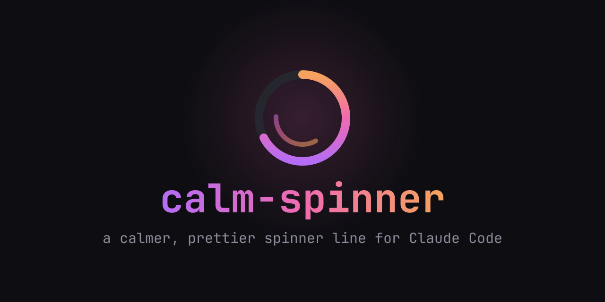
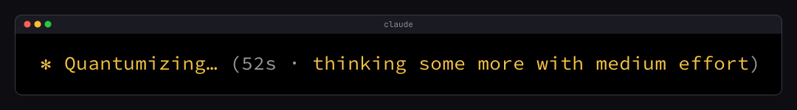

# calm-spinner



A [Claude Code](https://docs.anthropic.com/en/docs/claude-code) mod that replaces the spinner line shown while Claude works with an animated braille spinner, a label for what it is doing with a bright band sweeping across it, and the elapsed time.

## Before

The stock line rotates through whimsical verbs and spells out the effort level:



## After


| Mode | Shown as |
| --- | --- |
| thinking | ⠹ thinking |
| responding | ⠹ writing |
| requesting | ⠹ waiting |
| tool input / tool use | ⠹ working |

The spinner steps through ten braille frames, one every 100 ms. Both are drawn in the `claude` color from your Claude Code theme, so they follow `/theme`. The label is dim except for a bold band three characters wide that moves one character every 100 ms, entering and leaving off the edges of the word. To use another color, set `BASE_COLOR` in `hooks/register.tsx` to any theme key, a named ANSI color such as `magenta` (drawn from your terminal's palette), or a hex value. When Claude Code overrides the spinner with a message of its own, that message gets the same treatment.

## Install

At the prompt of a Claude Code terminal session:

```
/plugin install calm-spinner --marketplace yashLadha/calm-spinner
```

Answer `y` to add the marketplace, then pick a scope (user scope applies it to every session).

## Developing locally

Clone the repository:

```sh
git clone https://github.com/yashLadha/calm-spinner.git
cd calm-spinner
```

Then load it with one of these:

- **One session from the folder:** `claude --plugin-dir /path/to/calm-spinner`. An interactive session watches the folder, so saving a file reloads the mod.
- **Every session, including ones the desktop app starts:** set `CLAUDE_CODE_PLUGIN_DIRS` to the absolute path, either in your shell or in the `env` block of `~/.claude/settings.json`. Separate several folders with `:`.

  ```json
  { "env": { "CLAUDE_CODE_PLUGIN_DIRS": "~/opensource/calm-spinner" } }
  ```

- **Hot reloading through the mods folder:** ask Claude to make or edit a mod in a session (the `plugin-authoring` skill). The first write under `~/.claude/dev-mods/<session-id>/` prompts "Enable hot reloading for this session?"; on `Enable for this session`, each mod folder there loads at the end of the turn and reloads after every turn that edits it. A symlink from that folder to a clone of this repository works too.

Once the mod has loaded, the engine writes its API types to `.claude-plugin/types/` (git ignored) along with a `tsconfig.json` this repository's own extends.

### Checks

```sh
claude plugin validate .
claude plugin test .
npx -p typescript tsc -p . --noEmit
```

`claude plugin test` refuses to run if a wrapper passes options before `plugin` (for example a launcher that adds `--settings`); call the Claude Code binary directly in that case.

### Layout

| Path | Purpose |
| --- | --- |
| `.claude-plugin/plugin.json` | Manifest |
| `.claude-plugin/marketplace.json` | Makes the repository installable with `/plugin install` |
| `hooks/hooks.json` | Points at the hooks module |
| `hooks/register.tsx` | The `ui.render` hook for `Spinner` and the turn timer |
| `hooks/register.test.ts` | Tests for the time format, highlight band and spinner frames |
| `types/index.d.ts` | The `$.state` contract |
